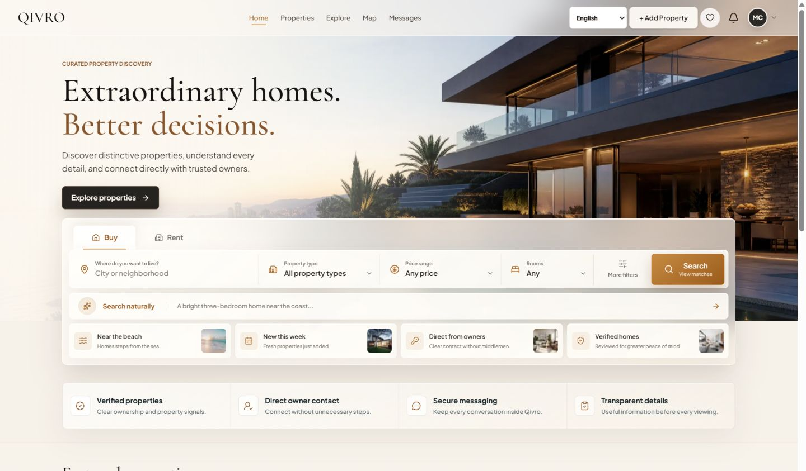
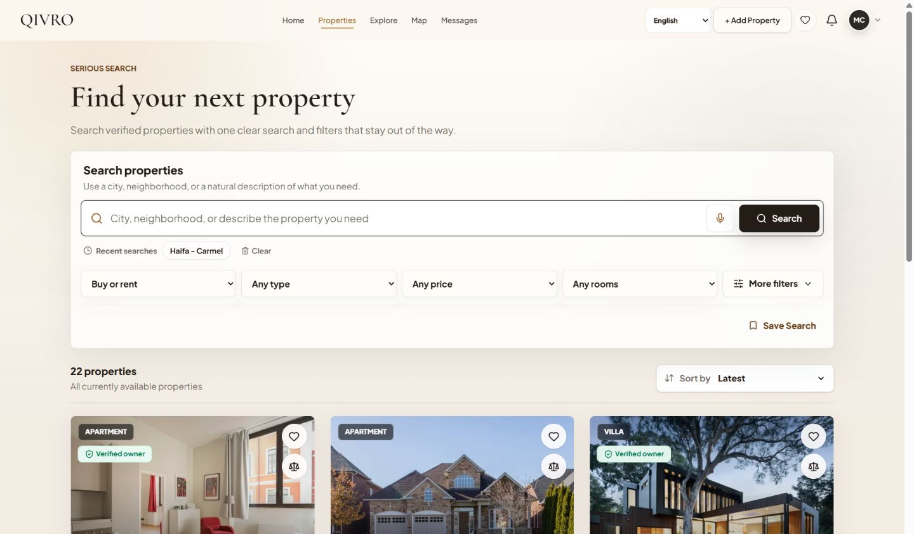
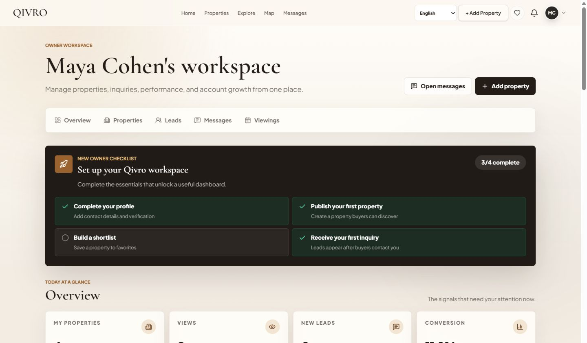
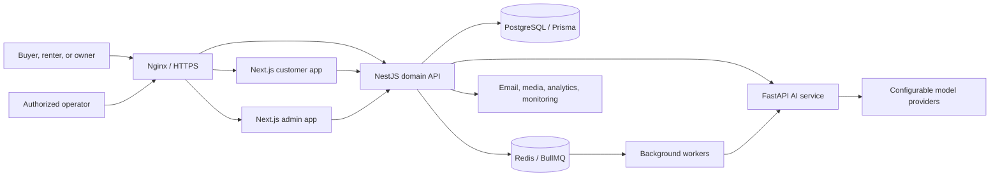
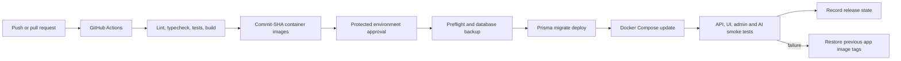

# Qivro

Qivro is a multilingual, multi-service real-estate platform that brings
property discovery, owner workflows, communication, operations, and controlled
AI assistance into one coherent engineering system.

| | |
| --- | --- |
| **Status** | Active personal/student engineering project |
| **Live demo** | Not publicly deployed yet |
| **Languages** | English, Arabic, and Hebrew with RTL support |
| **Architecture** | Independent services coordinated through Docker Compose |
| **Public repository scope** | Documentation and verified product evidence |

> This is the public engineering showcase for Qivro. Product source
> repositories are reviewed and released independently; this repository does
> not duplicate private source code or deployment secrets.

## Quick Review for Recruiters

- **See the product:** [Real local screenshots](#product-evidence) of search, property details, and the owner dashboard.
- **Understand the engineering:** [Service architecture](#system-architecture) and [delivery flow](#delivery-flow).
- **Check current scope:** [Implementation status](docs/PROJECT_STATUS.md) separates implemented and planned/provider-dependent features.
- **Understand source availability:** This is a public evidence/documentation repository, not the complete runnable source. The private service repositories require separate review before release. See the [public-release checklist](docs/PUBLIC_RELEASE_CHECKLIST.md).
- **Live demo:** Not publicly available. Do not interpret architecture diagrams or the delivery-flow illustration as proof of a running production deployment.

## October 2026 development\n\nRecent local work covers map discovery, owner insights, shared-living workflows, privacy/consent contracts, and native-client API alignment. See the [October development update](docs/DEVELOPMENT_UPDATE_2026_10.md) for scope and verification boundaries.\n\n## Product Evidence

The images below are real captures from the local Qivro environment using
deterministic seed users and properties. They contain no production or customer
data.

| Home and unified search | Property results |
| --- | --- |
|  |  |

| Property details | Owner workspace |
| --- | --- |
|  |  |

## What Qivro Covers

- Buyers and renters can discover, filter, compare, save, and inquire about
  properties.
- Authenticated users can create, preview, publish, and manage owned
  properties.
- Users can manage favorites, searches, messages, notifications, leads, and
  viewing appointments.
- Operators use a separate administration application for moderation, audit,
  analytics, experiments, translations, ranking, and AI review.
- Backend-controlled AI workflows support multilingual search parsing,
  property assistance, content generation, ranking, and translation contracts.

The Backend remains authoritative for authentication, authorization,
ownership, persistence, and provider access. Browser applications never connect
directly to databases, Redis, or model providers.

## System Architecture

Provider integrations are configuration-dependent. Their presence in the
architecture does not claim that every external account is connected in the
current environment.

## Service Boundaries

| Service | Responsibility | Main technologies | Public status |
| --- | --- | --- | --- |
| Customer web | Search, property pages, account and owner journeys | Next.js, React, TypeScript | Source under review |
| Domain API | Business rules, auth, data, messaging, jobs | NestJS, Prisma, PostgreSQL, Redis | Source under review |
| AI service | Search parsing, chat contracts, ranking, translation | FastAPI, Pydantic, provider adapters | Private security review |
| Infrastructure | Compose, Nginx, migrations, smoke, backup, rollback | Docker, Bash, GitHub Actions | Private security review |
| [Admin console](https://github.com/Ayham823/qivro-admin) | Moderation, audit, analytics and review workflows | Next.js, React, TypeScript | Public |
| Native client | iOS application foundation | Swift / SwiftUI | Early foundation |

## Implemented Engineering Areas

### Product and Frontend

- Property search, filters, map-aware results, details, favorites, and saved searches
- Property creation, editing, draft, validation, preview, and ownership-aware actions
- Leads, viewings, messaging, notifications, and account preferences
- English, Arabic, and Hebrew route localization with RTL layout support
- Responsive loading, empty, error, retry, offline, and session-expiry states

### Backend and Data

- Modular NestJS API with DTO validation and structured error contracts
- JWT-based authentication, role checks, ownership boundaries, and audit events
- PostgreSQL schema management through Prisma migrations
- Redis-backed caching, rate limiting, BullMQ jobs, and worker contracts
- Locale-aware APIs, versioned property translations, and notification templates

### AI Boundary

- FastAPI service with health, contract tests, request IDs, and structured logs
- Mock, OpenAI, and Gemini text-provider abstractions configured through the environment
- Multilingual search and chat contracts for English, Arabic, and Hebrew
- Guardrails that preserve property facts such as price, rooms, area, and address meaning
- Provider-dependent features remain explicit rather than being presented as live

### Delivery and Operations

- Docker Compose service networking for web, API, AI, PostgreSQL, Redis, workers, and Nginx
- Health and readiness checks plus API, UI, admin, and signed AI smoke tests
- Immutable application image tags for staging and production contracts
- Pre-deploy backup, forward-only migrations, release state, and application rollback
- GitHub Actions validation and container-image build workflows

## Delivery Flow

Database migrations are forward-only. Rolling back an application image does
not automatically reverse a schema migration.

## Honest Project Status

### Implemented or locally verified

- Core customer and owner property workflows
- Admin operations foundation
- Multilingual routes, formatting, RTL, and localized system content
- Backend API, PostgreSQL, Redis, queues, and worker boundaries
- AI provider abstraction with deterministic mock behavior
- Docker-based local environment, checks, migrations, and smoke tooling

### In development or provider-dependent

- Public production deployment and live demo
- Production payment provider and full webhook lifecycle
- AI-generated media and production 3D reconstruction
- Native iOS product beyond its current foundation
- Managed AWS database/cache, centralized observability, and infrastructure as code

## What This Project Demonstrates

Qivro is primarily an engineering-learning project. It demonstrates hands-on
work across:

- Next.js interfaces and NestJS APIs
- Relational data modeling, migrations, Redis, queues, and workers
- Authentication, authorization, validation, and service boundaries
- Python/FastAPI integration behind a Backend-controlled provider layer
- Linux/WSL troubleshooting and multi-container networking
- Dockerfiles, Docker Compose, Nginx, CI checks, release scripts, and runbooks
- Separating implemented, mock, provider-dependent, and planned capabilities

It is not presented as a claim of professional production-operations
experience or as a currently operating real-estate business.

## Additional Documentation

- [Architecture notes](docs/ARCHITECTURE.md)
- [Implementation status](docs/PROJECT_STATUS.md)
- [Screenshot and data policy](docs/SCREENSHOTS.md)
- [Security policy](SECURITY.md)

## Public Release Policy

No environment files, credentials, certificates, database exports, backups,
logs, customer data, or private provider configuration belong in this
repository. Each source repository must pass its own current-tree and reachable
history review before any visibility change.

## License

Copyright (c) 2026 Ayham Mhameed. This showcase is publicly viewable, but no
permission to copy, modify, redistribute, or use its documentation or visual
assets is granted unless stated otherwise in [LICENSE](LICENSE).
