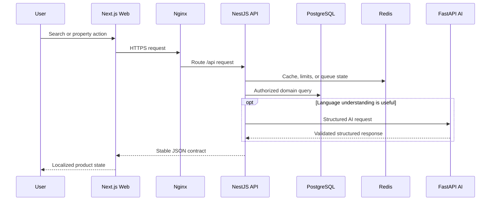

# Qivro Architecture Notes

## Request Path

## Design Principles

1. The Backend owns business rules, authorization, and persistence.
2. Frontend applications consume stable HTTP contracts.
3. The AI service is an adapter boundary, not a source of authority.
4. Redis supports caching, rate limiting, queues, and realtime coordination.
5. Long-running or retryable work belongs in background workers.
6. Public traffic enters through Nginx; internal services use Docker DNS.
7. External providers are optional adapters with deterministic fallbacks where appropriate.

## Data and AI Safety

- Original owner-entered property content is preserved.
- Generated translations are versioned and reviewed before publication.
- Model responses are validated before affecting product behavior.
- Property facts are sourced from Qivro data, not invented by a model.
- Secrets and provider keys stay outside browser applications and Git history.

## Environment Progression

The current architecture targets a Docker Compose environment on a single
Linux host. The service boundaries are designed to permit later movement to
managed PostgreSQL, managed Redis, container registries, load balancing, and
orchestrated compute without rewriting the product domains.

## API boundary and ownership

| Caller | Boundary | Responsibility |
| --- | --- | --- |
| Customer web and native clients | NestJS HTTP API | Authenticated search, listing, owner, messaging and account contracts |
| Admin application (private source) | NestJS admin endpoints | Privileged review and operations with backend role checks |
| NestJS API | PostgreSQL / Prisma | Domain state, ownership and migrations |
| NestJS API | Redis / workers | Cache, limits and asynchronous job state |
| NestJS API | FastAPI AI service | Structured, validated AI requests; no direct browser provider access |

This is a boundary map, not a versioned endpoint catalog. Consumers should use
current service contracts from the private source. A route in source alone does
not prove an accepted end-to-end journey or a production deployment.

## AI request lifecycle

The backend authorizes a request and supplies the permitted property facts.
FastAPI performs a bounded task through a configured adapter or deterministic
mock, returns a structured response, and the backend validates it before a
client receives it. External provider availability depends on configuration.
Generated text must not override listing facts, ownership or publication rules.
See [project status](PROJECT_STATUS.md) for the evidence boundary.

## Docker and AWS delivery boundary

Docker Compose coordinates development services and their health checks.
Nginx is the intended public edge; application containers communicate over
internal service names. Release scripts and workflows describe image builds,
forward-only Prisma migrations, smoke checks, backups and application-image
rollback. A previous image does not reverse a database migration.

AWS host, storage and managed-service details depend on the deployment
configuration and are not reproduced in this public showcase. Before claiming
a particular release is live, record its image digest, migration state, smoke
results, backup/restore evidence and observation time in a sanitized release
record. Public documentation and diagrams alone do not prove those checks.
