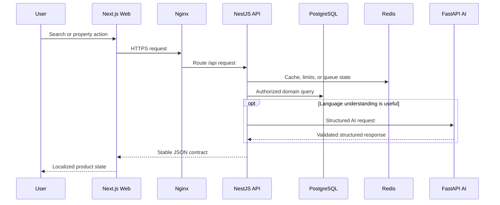

# Qivro Architecture Notes

## Request Path

## Design Principles

1. The Backend owns business rules, authorization, and persistence.
2. Frontend applications consume stable HTTP contracts.
3. The AI service is an adapter boundary, not a source of authority.
4. Redis supports caching, rate limiting, queues, and realtime coordination.
5. Long-running or retryable work belongs in background workers.
6. Public traffic enters through Nginx; internal services use Docker DNS.
7. External providers are optional adapters with deterministic fallbacks where appropriate.

## Data and AI Safety

- Original owner-entered property content is preserved.
- Generated translations are versioned and reviewed before publication.
- Model responses are validated before affecting product behavior.
- Property facts are sourced from Qivro data, not invented by a model.
- Secrets and provider keys stay outside browser applications and Git history.

## Environment Progression

The current architecture targets a Docker Compose environment on a single
Linux host. The service boundaries are designed to permit later movement to
managed PostgreSQL, managed Redis, container registries, load balancing, and
orchestrated compute without rewriting the product domains.
