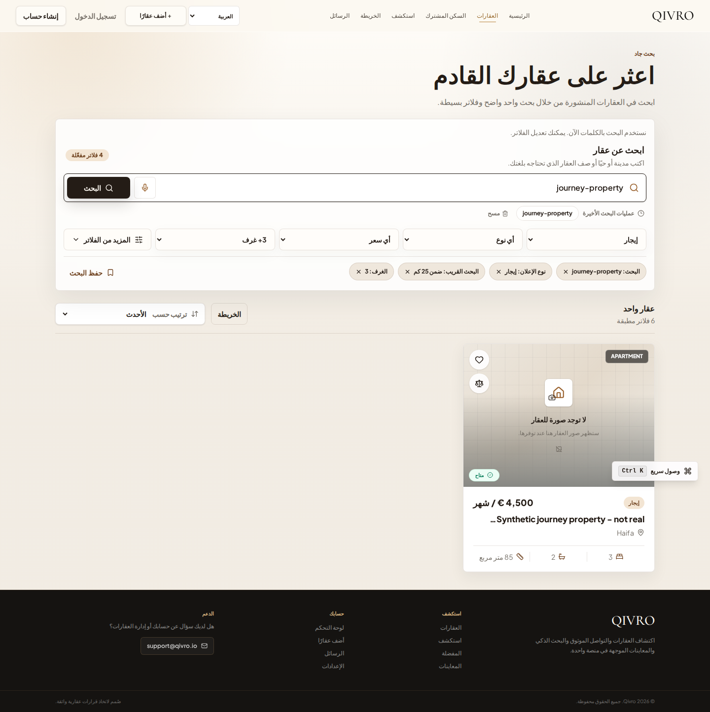
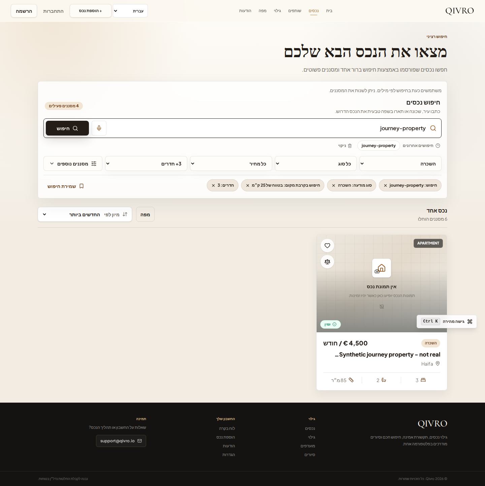

# Multilingual UI demonstration — October 19, 2026

These images were captured from the running Next.js production build by Playwright. The API was an isolated, deterministic fixture. The property is explicitly synthetic; the displayed price, location and inventory are test values. No customer or production data appears, and no property photograph was fabricated.

This demonstrates the rendered search interface, filters, language routing, and Arabic/Hebrew RTL layout. It does not establish a public production deployment or measure model quality. The broader browser suite also exercises login return paths, draft retention, favorites and contact/viewing UI against controlled fixture responses.

## English

## العربية

## עברית

## Capture and verification scope

The captures come from source commit `9a82fb85c8914d53b43d57a2ddd6be5e1e19bbf1` and GitHub Actions run `39265544832`. All four viewport jobs ultimately passed. The Hebrew desktop journey completed on its recorded retry after a transient duplicate streamed search region; the follow-up test now waits for region uniqueness. Image hashes and artifact provenance are recorded in [the manifest](DEMO_PROVENANCE_2026_10_19.json).

Source repositories remain subject to their independent release/security reviews. The public showcase contains reviewed visual evidence and documentation.
