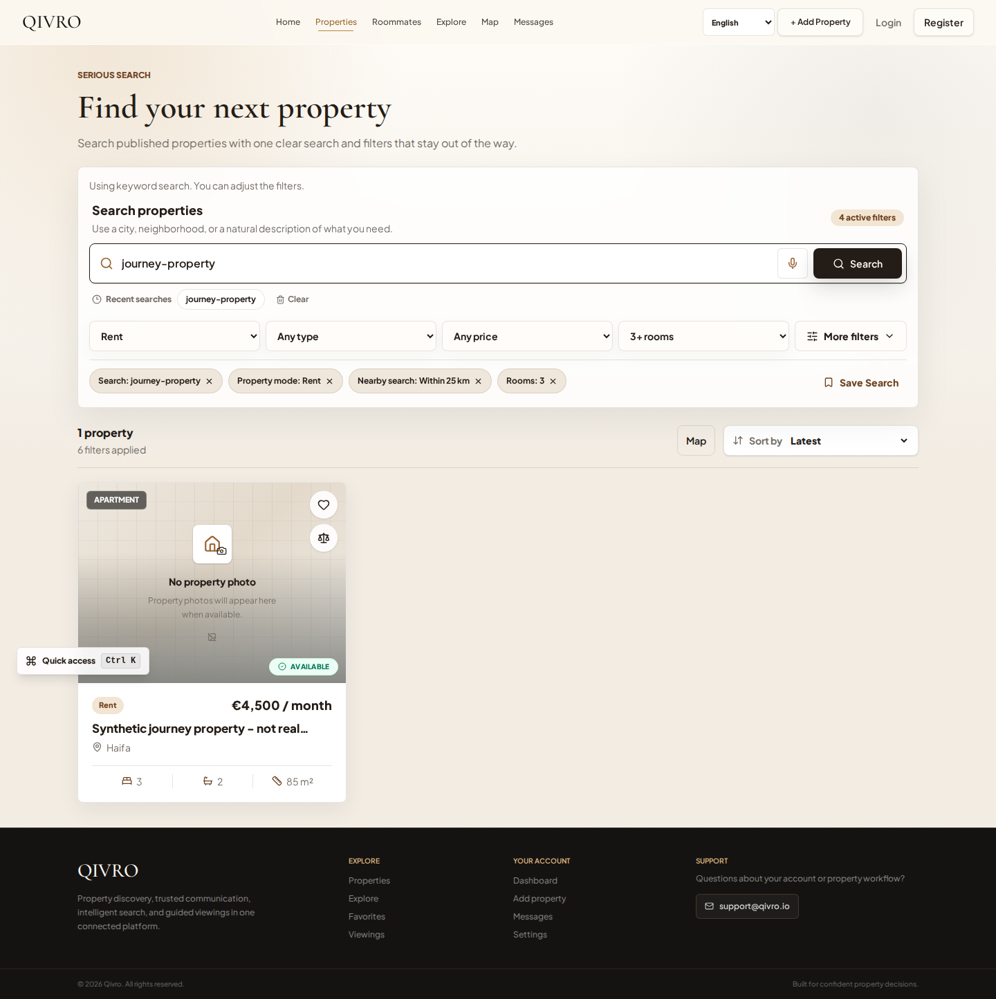

# English UI demonstration — October 19, 2026

This image was captured from the running Next.js production build by Playwright. The API was an isolated, deterministic fixture. The property is explicitly synthetic; the displayed price, location and inventory are test values. No customer or production data appears, and no property photograph was fabricated.

This demonstrates the rendered English search interface and filters. It does not establish a public production deployment or measure model quality. The broader browser suite also exercises login return paths, draft retention, favorites and contact/viewing UI against controlled fixture responses.

## Capture and verification scope

The English capture comes from source commit `9a82fb85c8914d53b43d57a2ddd6be5e1e19bbf1` and GitHub Actions run `39265544832`, on its first attempt. All four viewport jobs ultimately passed. The image hash and artifact provenance are recorded in [the manifest](DEMO_PROVENANCE_2026_10_19.json). The artifact contains the broader browser-run evidence; this gallery selects only the English capture.

Source repositories remain subject to their independent release/security reviews. The public showcase contains reviewed visual evidence and documentation.
